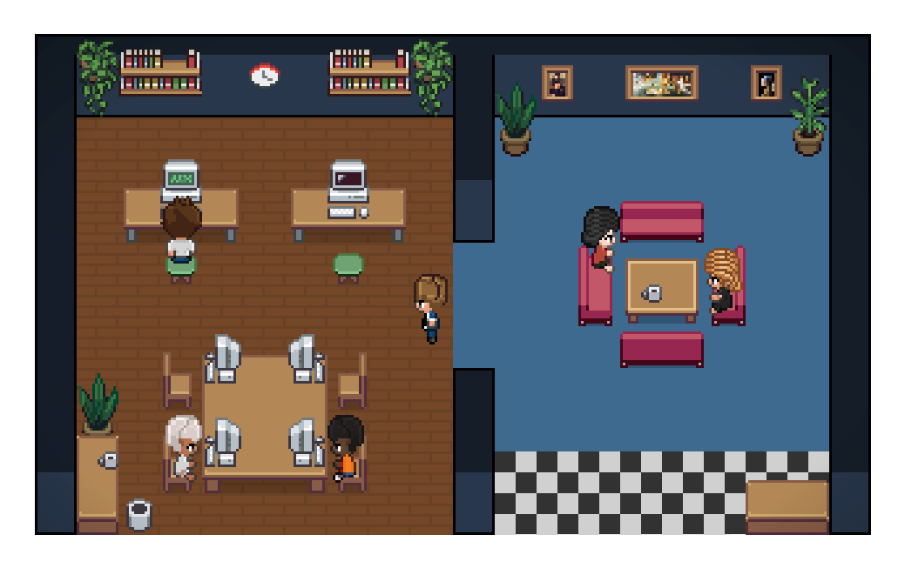

# Pixel Agents Fleet

**把本地与远程的多个 AI Agent、多个对话，放进同一个像素办公室。**

由 [Zhao-zixi](https://github.com/Zhao-zixi) 维护的 Pixel Agents Fleet，在上游 Pixel Agents 的像素办公室基础上，增加多 Agent 小队、SSH 环境、多对话角色、事件时间线和工作区改动视图。**Fleet 功能运行在独立的浏览器模式中**；现有 VS Code 扩展代码保留，但扩展内暂未加入 Fleet 面板。

[下载 Windows 版本](https://github.com/Zhao-zixi/pixel-agents-fleet/releases/latest) · [问题与建议](https://github.com/Zhao-zixi/pixel-agents-fleet/issues) · [详细接入文档](README.fleet.zh-CN.md) · [MIT 许可证](LICENSE)



> 上图展示基础办公室界面。Fleet 的进程分组、会话和诊断入口位于「多 Agent 小队」面板。

## 能做什么

- **多种 Agent 并行运行**：提供 Claude Code、Codex、Gemini、OpenCode 配置，也能接入自定义 CLI。
- **一个活跃对话一个小人**：同一 Agent 进程的多个对话分别展示状态和输出，共享一个终端；支持隐藏、恢复及已完成角色自动收起。
- **本地 + SSH**：不同项目目录、不同远程主机统一管理，沿用现有 OpenSSH 配置。
- **事件时间线**：按进程或对话查看状态历史，可选持久化状态元数据；回放不会重新执行任务。
- **SSH 状态诊断**：区分连接状态和 Agent 状态，提供只读连接、目录与命令检查；断线后的远端执行状态可能为「未知」。
- **工作区改动**：只读查看 Git 差异、启动前已有改动及共享工作区的潜在冲突，不自动提交或回滚。
- **可编辑的像素办公室**：布置桌椅、地板、墙面和区域，导入导出布局。

多对话拆分依赖 Agent 输出中的会话 ID，并不是把任意终端文字自动识别成多个对话。默认的一次性 CLI 调用通常仍对应一个对话。自定义事件协议见[详细文档](README.fleet.zh-CN.md#自定义-agent-的多对话事件)。

## Windows 快速开始

优先提供 **Windows x64 便携 ZIP**。这不是签名安装器，也不是单文件 EXE。

1. 在 [Releases](https://github.com/Zhao-zixi/pixel-agents-fleet/releases/latest) 下载 Windows x64 ZIP，解压到可写目录。
2. 双击 `start-fleet.cmd`。
3. 打开终端打印的完整本机 URL，保留其中的 `?token=...`。
4. 点击「多 Agent 小队」，选择环境并启动任务。

便携包包含 Node.js 运行时，无需另外安装 Node.js。但它**不包含 Agent CLI、模型账号或 SSH 配置**：请先安装并登录你要使用的 Agent，确认在终端里可以正常运行。使用 SSH 功能还需要本机 OpenSSH 客户端以及已经验证的远程主机配置。

默认配置使用服务的启动工作目录。操作真实项目时，推荐明确指定配置文件，不要把解压目录误当成项目目录。

### 配置自己的项目

创建 `fleet.config.json`，例如：

```json
[
  {
    "id": "local-codex",
    "name": "本地 Codex",
    "provider": "codex",
    "mode": "task",
    "cwd": "C:\\Projects\\my-app"
  },
  {
    "id": "remote-claude",
    "name": "服务器上的 Claude",
    "provider": "claude",
    "mode": "task",
    "ssh": "dev-box",
    "cwd": "/srv/projects/my-app"
  }
]
```

在解压目录的命令提示符中运行：

```bat
start-fleet.cmd --fleet "C:\Projects\fleet.config.json"
```

JSON 中 Windows 路径的反斜杠需要写成 `\\`，或使用 `C:/Projects/my-app`。删除不需要的配置项；配置在启动时读取，修改后重启服务。

### SSH 接入

先在本机终端执行 `ssh dev-box`，核对主机指纹，确保登录正常、远端项目目录存在且 CLI 可运行。Fleet 使用严格主机密钥校验和非交互式认证，不会自动接受陌生主机，也不会替你生成密钥或关闭校验。

远端需要 POSIX shell。若 CLI 只在交互式 shell 的 PATH 中可见，在配置中用 `command` 指定其绝对路径。已有 tmux 会话可通过自定义交互配置附着，见[SSH 与已有 Agent 接入说明](README.fleet.zh-CN.md#接入已经运行的远程-agent)。

## 从源码运行

开发和打包建议使用 **Node.js 22**。下面的操作适用于已安装 Git 和 Node.js 的开发环境：

```bash
git clone https://github.com/Zhao-zixi/pixel-agents-fleet.git
cd pixel-agents-fleet
npm ci
npm run build
npm run fleet
```

指定配置：

```bash
npm run fleet -- --fleet fleet.config.json
```

### 无模型离线演示

构建后运行：

```bash
npm run fleet:demo
```

打开终端打印的 URL，在「多 Agent 小队」选择「演示·一个 Agent 三个对话」。启动一次即可观察三个对话小人、输出隔离、共享终端以及完成后收起。演示使用模拟事件，不调用收费模型、不修改你的项目文件。

## 一键打包 Windows

在 **Windows x64 + Node.js 22** 的源码目录中运行：

```bash
npm run package:windows
```

也可以双击仓库根目录的 `package-windows.cmd`，或直接执行：

```powershell
powershell -File scripts/package-windows.ps1
```

打包脚本安装依赖、构建应用并生成包含 Node.js 运行时的便携包。首次打包需要联网下载依赖和官方 Node.js 运行时。发布产物及校验文件以 [Releases](https://github.com/Zhao-zixi/pixel-agents-fleet/releases) 页面为准。

如果 PowerShell 提示执行策略禁止运行脚本，请遵循你所在设备的安全策略，由你决定是否允许运行这个可信脚本；打包器不会修改系统执行策略。也可直接使用 Release 便携包，运行它不依赖 PowerShell。

本仓库的发布目标是 **GitHub Release**。不要用上游的 `npx pixel-agents` 或上游 Marketplace 页面安装这个 Fleet 分支；本分支没有声明已发布到 npm、VS Code Marketplace 或 Open VSX。

## 使用边界与安全

- 服务默认只监听 `127.0.0.1`。终端 URL 中的 token 是操作凭据，不要公开、截图分享或发送给不信任的人。需要外网访问时，请自行采用可信的受控访问方式。
- 默认保留 Agent CLI 自己的审批与沙箱策略，不自动添加跳过权限检查参数。运行真实 Agent 仍可能修改文件、执行命令或产生模型费用。
- 「收起小人」只隐藏角色；「停止整个 Agent」针对进程组。SSH 断线或停止本地连接不保证远端已脱离终端的任务停止，也不会自动重连重跑。
- 进程和终端输出不在服务重启后恢复。可选持久化时间线仅记录有限的状态元数据，不保存任务内容或终端输出，不提供任务恢复执行。
- 工作区差异有时间、文件数和大小限制。敏感路径会过滤，但这不是完整的秘密检测器；潜在重叠提示不能证明某个 Agent 修改了某个文件。
- **真实远程服务器以及各 Agent 的具体版本、账号和模型权限仍需实际验证。** 模拟测试或本地测试不能替代你的真实环境验收。

## 开发与验证

```bash
npm run check-types
npm run lint
npm test
npm run test:fleet
```

按需运行端到端测试：

```bash
npm run e2e
```

日常 CI 保持单个轻量 Linux 任务，完整跨平台测试仅手动启动并需明确确认。Dependabot 自动版本升级保持暂停。发布打包与完整测试不是每次提交都运行的大矩阵；手动运行也可能消耗 GitHub Actions 额度，不代表保证免费。详见 [CI 用量控制](README.fleet.zh-CN.md#ci-用量控制)。

当前测试结果以对应提交的 [Actions](https://github.com/Zhao-zixi/pixel-agents-fleet/actions) 和 Release 说明为准，详细接入文档中的早期测试记录不代表每个版本都已通过相同验证。

### 代码结构

- `server/src/fleet/`：环境配置、进程与对话管理、事件适配、时间线、SSH 诊断和工作区差异。
- `server/`：共享服务、终端与独立 CLI。
- `webview-ui/`：React 界面与 Canvas 像素办公室。
- `core/`：类型、协议与共享接口。
- `adapters/vscode/`：保留的 VS Code 适配器。
- `scripts/`：构建、打包、演示和验证脚本。

欢迎在[本仓库 Issues](https://github.com/Zhao-zixi/pixel-agents-fleet/issues) 提交问题、复现步骤或功能建议。

## 许可证与致谢

本项目基于 [pixel-agents-hq/pixel-agents](https://github.com/pixel-agents-hq/pixel-agents) 开发，感谢 Pablo De Lucca 及上游贡献者。Fleet 分支由 Zhao-zixi 维护，保留上游 [MIT 许可证及版权声明](LICENSE)，不把上游代码声明为原创。

角色素材感谢 [JIK-A-4 的 Metro City 角色包](https://jik-a-4.itch.io/metrocity-free-topdown-character-pack)。字体许可见 [Noto Sans SC / SIL Open Font License](docs/licenses/NotoSansSC-OFL.txt)。代码许可证不替代第三方素材和依赖各自的许可；分发时须保留相应声明。
